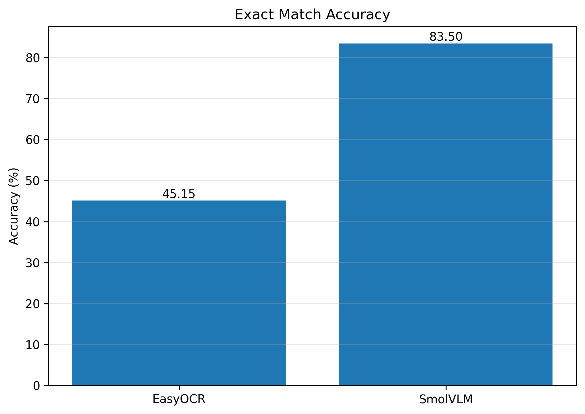
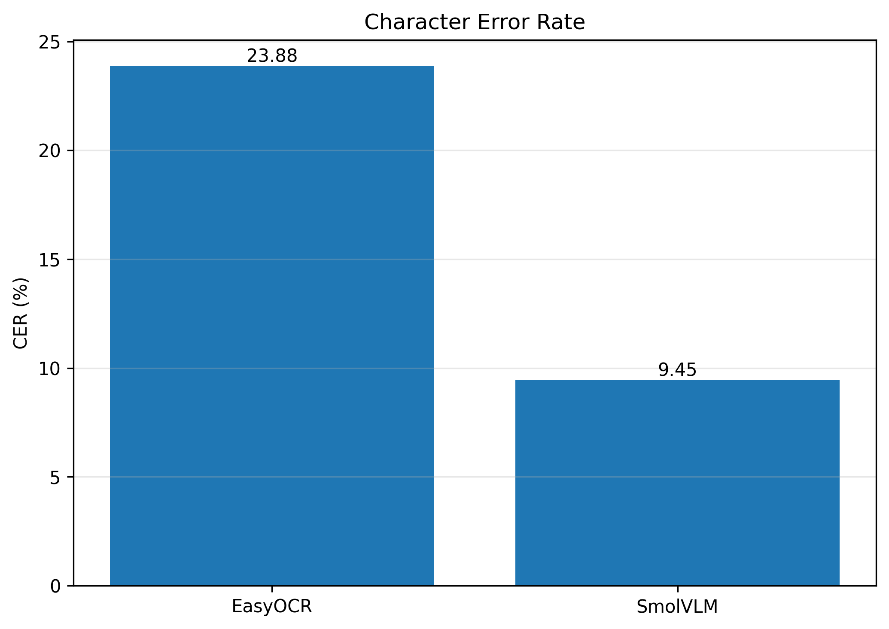
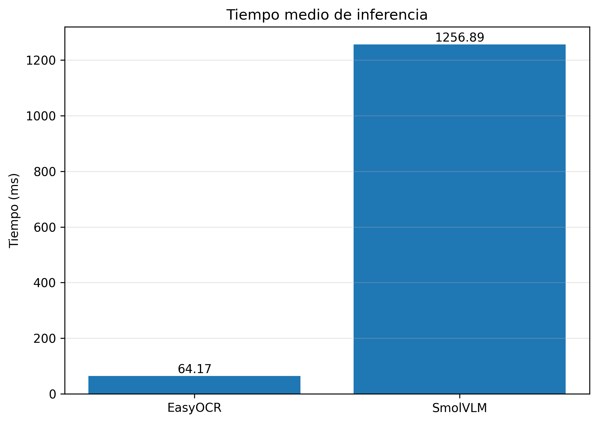

# VC - Práctica 4 - Detección de vehículos y matrículas, Reconocimiento de caracteres en matrículas

## Autor

- Sergio Dámaso Guerra

## Estructura del repositorio

- `VC_P4.ipynb`: cuaderno jupyter de la práctica.
- `label.py`: script para trasnformar el dataset original para el entrenamiento con YOLO.
- `yolo11n.pt`: parámetros del modelo YOLO11n (COCO).
- `lp_weights/`: parámetros del modelo YOLO entrenado para matrículas.
- `data.yaml`: fichero que define ubicación de datos y las clases para el entrenamiento.
- `detecciones/`: ficheros csv para las detecciones.
- `resultados_ocr/`: gráficas comparativas de OCRs.
- `dataset_ocr.zip`: conjunto de datos comprimido para la comparación de OCRs.
- `README.md`: documentación de la práctica.

## 1. Descripción del proyecto

El objetivo de esta práctica es desarrollar un sistema de visión artificial capaz de detectar vehículos en vídeo, localizar sus matrículas y reconocer el texto de estas mediante técnicas de OCR (*Optical Character Recognition*).

Para ello, se combinan dos modelos YOLO, dos alternativas de OCR (EasyOCR y SmolVLM) y un sistema de seguimiento de objetos (*tracking*). Finalmente, los resultados se almacenan en archivos CSV para facilitar su posterior análisis.

## 2. Procesamiento del vídeo

[Enlace al video de test](https://alumnosulpgc-my.sharepoint.com/:v:/g/personal/mcastrillon_iusiani_ulpgc_es/EXRsnr4YuQ9CrhcekTPAD8YBMHgn16KwlunFg32iZM0xVQ?e=kzuw4l)

### 2.1. Detección de vehículos

Se utiliza el modelo preentrenado **YOLO11n (COCO)** para detectar personas, bicicletas y vehículos (coches). Esta detección se ejecuta en todos los fotogramas del vídeo.

Además, se utiliza `model.track()` para realizar el seguimiento de los objetos y asignar identificadores únicos (*tracking ID*) a cada uno de ellos. Estos identificadores permiten mantener la información asociada a un vehículo a lo largo de distintos fotogramas.

### 2.2. Detección de matrículas

Se emplea un segundo modelo YOLO11n, entrenado específicamente para detectar matrículas.

Para reducir el coste computacional, este modelo no se ejecuta en todos los fotogramas, sino cada dos fotogramas.

### 2.3. Asociación de matrículas y vehículos

Una vez detectadas las matrículas, se asocian con los vehículos correspondientes mediante sus bounding boxes.

Para ello, se calcula el centro de cada matrícula y se comprueba si este punto se encuentra dentro de la región delimitada por alguno de los vehículos detectados.

En caso de existir varios candidatos, se selecciona el vehículo con la bounding box de menor área, que normalmente corresponde al vehículo más cercano que contiene la matrícula.

La asociación se realiza utilizando el identificador de tracking del vehículo.

### 2.4. Reconocimiento OCR

Una vez localizada y asociada una matrícula, se aplica uno de los dos sistemas OCR disponibles:

- **EasyOCR:** biblioteca especializada en reconocimiento de texto a partir de imágenes.
- **SmolVLM:** modelo multimodal de visión y lenguaje (`HuggingFaceTB/SmolVLM-256M-Instruct`), al que se le proporciona la imagen de la matrícula junto con una instrucción para obtener únicamente sus caracteres.

El OCR se ejecuta con un intervalo aproximado de 0,25 segundos, siempre que se cumplan las condiciones necesarias:

- La matrícula debe tener un tamaño mínimo de 80 píxeles de ancho y 20 de alto.
- No debe haberse reconocido previamente una matrícula válida para ese vehículo.
- Debe haberse cumplido el intervalo entre intentos.
- No se deben haber superado los tres intentos máximos por vehículo.

Las matrículas reconocidas se validan mediante una expresión regular correspondiente al formato español: cuatro dígitos seguidos de tres letras, excluyendo las vocales y algunas consonantes.

### 2.5. Exportación de resultados

Toda la información obtenida se almacena en un CSV, incluyendo:

- Fotograma y tipo de objeto detectado.
- Confianza de la detección.
- Identificador de tracking.
- Coordenadas de la bounding box del vehículo.
- Existencia y coordenadas de la matrícula.
- Texto reconocido y confianza del OCR.
- [Videos demostración](https://drive.google.com/drive/folders/1wq5Y_t5fXSmz5sAwzU5Ar7s44A_hY5Ii?usp=sharing)

Se generan dos archivos por cada ejecución:

- `detecciones_easyOCR.csv` / `detecciones_smolVLM.csv`: contiene todas las detecciones.
- `detecciones_matricula_easyOCR.csv` / `detecciones_matricula_smolVLM.csv`: contiene únicamente las detecciones que tienen una matrícula reconocida.

---

## 3. Entrenamiento del detector de matrículas

El detector de matrículas se ha entrenado utilizando **YOLO11n**, partiendo de un conjunto de datos de aproximadamente 1.500 imágenes de matrículas ([UC3M-LP](https://github.com/ramajoballester/UC3M-LP)), adaptado al formato de anotaciones requerido por YOLO.

### 3.1. Configuración del entrenamiento

| Parámetro | Valor |
|---|---|
| Modelo | YOLO11n |
| Tamaño de imagen (`imgsz`) | 640 × 640 |
| Batch size | 2 |
| Scale | 0.8 |
| Épocas | 15 |
| Workers | 4 |
| Dataset | [UC3M-LP](https://github.com/ramajoballester/UC3M-LP) (aprox. 1.500 imágenes) |

Este repositorio ya incluye el modelo previamente entrenado. No obstante, si deseas reentrenarlo con otras configuraciones, primero descarga el dataset desde el enlace de la tabla. A continuación, abre el script `label`.py para ajustar los directorios de origen y destino según tus necesidades, y copia el archivo `data.yaml` dentro de dicha carpeta de destino. Una vez preparado el entorno, podrás iniciar el entrenamiento ejecutando el comando `yolo detect train`, especificando la ruta de tu archivo `data.yaml`.

### 3.2. Hardware utilizado

El entrenamiento se ha realizado en un portátil con las siguientes características:

- **GPU:** NVIDIA GeForce RTX 2060 (6 GB GDDR6).
- **CPU:** Intel Core i7-10750H.
- **RAM:** 16 GB DDR4 (2 × 8 GB a 2666 MHz).

El tiempo total de entrenamiento ha sido de aproximadamente **32 minutos**.

### 3.3. Evolución y resultados

El entrenamiento ha mostrado una evolución positiva a lo largo de las 15 épocas ejecutadas.

Se observa una reducción progresiva de las funciones de pérdida (*loss*), tanto en entrenamiento como en validación:

- Pérdida de clasificación (`cls_loss`): 5.53 → 0.50.
- Pérdida de localización (`box_loss`): 1.38 → 0.77.
- Pérdida de distribución focal (`dfl_loss`): 1.07 → 0.90.

En cuanto a las métricas de evaluación, los resultados obtenidos en la última época son satisfactorios:

| Métrica | Resultado |
|---|---:|
| Precision | 97.47 % |
| Recall | 97.33 % |
| mAP50 | 99.23 % |
| mAP50-95 | 81.62 % |

Destaca especialmente el mAP50 del 99.23 %, que refleja una excelente capacidad de detección. Por su parte, el mAP50-95 del 81.62 % indica que todavía existe cierto margen de mejora en la precisión de las bounding boxes.

En principio, no se aprecian indicios evidentes de sobreajuste durante estas 15 épocas, puesto que las pérdidas de validación también presentan una tendencia descendente. No obstante, estas métricas corresponden al conjunto de validación y no garantizan por sí solas el mismo rendimiento en cualquier escenario real.

---

## 4. Comparativa de sistemas OCR

Se ha realizado un experimento para comparar el rendimiento de EasyOCR y SmolVLM en el reconocimiento de matrículas.

### 4.1. Procedimiento experimental

Se ha preparado un conjunto de imágenes de prueba que contienen matrículas cuyo texto real es conocido. Este texto se obtiene a partir del nombre de cada imagen.

Para cada imagen se ejecutan ambos sistemas OCR y se almacenan en un CSV:

- Nombre de la imagen.
- Texto real de la matrícula.
- Texto reconocido por EasyOCR.
- Texto reconocido por SmolVLM.
- Tiempo de inferencia de cada sistema.

De esta forma, ambos OCR se evalúan sobre exactamente las mismas imágenes, permitiendo realizar una comparación directa.

### 4.2. Métricas utilizadas

Para evaluar los resultados se han calculado las siguientes métricas:

- **Accuracy (Exact Match):** porcentaje de imágenes en las que el texto reconocido coincide exactamente con la matrícula real.
- **CER (Character Error Rate):** porcentaje de errores de carácter respecto al número total de caracteres reales. Cuanto menor sea, mejor.
- **Formato válido:** porcentaje de predicciones que cumplen el formato español de matrícula.
- **Tiempo medio:** tiempo medio necesario para procesar una imagen.
- **Mediana y P95:** permiten analizar la distribución de los tiempos de inferencia y su variabilidad.

### 4.3. Resultados

Se han evaluado un total de **206 imágenes**.

| Métrica | EasyOCR | SmolVLM |
|---|---:|---:|
| Imágenes evaluadas | 206 | 206 |
| Correctas | 93 | 172 |
| Accuracy | 45.15 % | 83.50 % |
| CER | 23.88 % | 9.45 % |
| Formato válido | 47.57 % | 84.47 % |
| Tiempo medio | 64.17 ms | 1256.89 ms |
| Mediana | 43.47 ms | 1245.31 ms |
| P95 | 146.55 ms | 1700.18 ms |

### 4.4. Gráficas

Se generan gráficas comparativas para visualizar las principales diferencias entre ambos sistemas:

### 4.5. Conclusiones de la comparativa

Los resultados muestran diferencias importantes entre los dos sistemas OCR.

**EasyOCR** presenta un tiempo medio de inferencia considerablemente menor, de aproximadamente 64 ms por imagen. Sin embargo, su precisión es bastante inferior, alcanzando un 45.15 % de coincidencias exactas. Esto lo convierte en una alternativa interesante cuando la velocidad de procesamiento es prioritaria, aunque sus resultados de reconocimiento son más limitados.

Por otro lado, **SmolVLM** consigue un rendimiento de reconocimiento notablemente superior, con un 83.50 % de coincidencias exactas y un CER del 9.45 %. No obstante, su tiempo medio de inferencia supera los 1.2 segundos por imagen, siendo aproximadamente 19.6 veces más lento que EasyOCR.

En consecuencia, existe un compromiso entre velocidad y precisión: EasyOCR permite procesar imágenes mucho más rápidamente, mientras que SmolVLM consigue reconocer correctamente un número considerablemente mayor de matrículas.

Para este proyecto, donde resulta especialmente importante obtener el texto correcto de las matrículas, SmolVLM ofrece mejores resultados de reconocimiento, aunque su mayor coste computacional puede limitar su utilización en aplicaciones que requieran procesamiento en tiempo real.